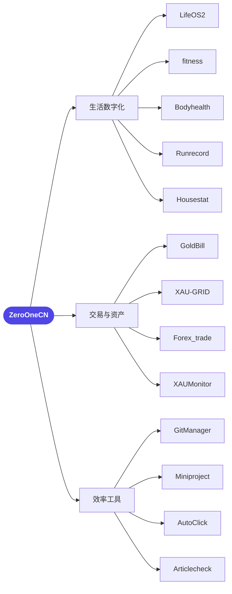

### 把生活里的琐事，做成真正能用的工具。

 

<picture>
  <source media="(prefers-color-scheme: dark)" srcset="https://github-readme-stats.vercel.app/api?username=ZeroOneCN&show_icons=true&hide_border=true&include_all_commits=true&count_private=true&bg_color=00000000&title_color=FFFFFF&text_color=C9D1D9&icon_color=818CF8&rank_icon=github" />
  
</picture>
<picture>
  <source media="(prefers-color-scheme: dark)" srcset="https://github-readme-stats.vercel.app/api/top-langs/?username=ZeroOneCN&layout=compact&langs_count=8&hide_border=true&bg_color=00000000&title_color=FFFFFF&text_color=C9D1D9&exclude_repo=ZeroOneCN" />
  
</picture>
<picture>
  <source media="(prefers-color-scheme: dark)" srcset="https://streak-stats.demolab.com?user=ZeroOneCN&hide_border=true&background=00000000&stroke=30363D&ring=6366F1&fire=F59E0B&currStreakLabel=818CF8&sideLabels=C9D1D9&dates=8B949E&currStreakNum=FFFFFF&sideNums=FFFFFF" />
  
</picture>

 

## 三个方向

| 🧬 生活数字化 | 💹 交易与资产 | ⚙️ 效率工具 |
| :--- | :--- | :--- |
| 把身体、作息、账单、居住成本全部变成可分析的数据 | 记录行情与交易，用数据复盘而不是靠感觉 | 把每天重复的手工操作，做成一键完成的小工具 |
| `LifeOS2` `fitness` `Bodyhealth` `Runrecord` | `GoldBill` `XAU-GRID` `Forex_trade` | `GitManager` `Miniproject` `AutoClick` |

## 精选项目

| | 项目 | 说明 | 技术 |
| :--- | :--- | :--- | :--- |
| 🔥 | **[Articlecheck](https://github.com/ZeroOneCN/Articlecheck)** | 基于百度翻译 API 的论文降重工具，多语言转换 + AIGC 降重 · ★ 45 | `Python` |
| 📱 | **[fitness](https://github.com/ZeroOneCN/fitness)** | 完全离线的 Android 健身教练：1324 个动作、按周排计划、身体成分记录 | `Java` |
| 🧬 | **[LifeOS2](https://github.com/ZeroOneCN/LifeOS2)** | 把生活量化、数字化的应用，持续迭代中的主力项目 | `Dart` |
| 🌿 | **[GitManager](https://github.com/ZeroOneCN/GitManager)** | 管理本地 Git 仓库的可视化 Web 应用 | `Python` |
| 🎓 | **[Socialmatch](https://github.com/ZeroOneCN/Socialmatch)** | Spring Boot + Vue3 社交匹配应用，附完整 UML 建模与毕设文档 | `Java` `Vue` |
| 💰 | **[GoldBill](https://github.com/ZeroOneCN/GoldBill)** | 黄金白银交易分析平台，支持 MT5 记录导入 | `Python` |
| 🏠 | **[Housestat](https://github.com/ZeroOneCN/Housestat)** | 房租、水电、中介与服务费的住房花销记录 | `Vue` |
| ✈️ | **[Hnalines](https://github.com/ZeroOneCN/Hnalines)** | 海南航空飞飞乐会员航线查询与行程规划 | `JavaScript` |

## 项目地图

## 技术栈

## 更多仓库

| 分类 | 仓库 |
| :--- | :--- |
| **生活记录** | [Runrecord](https://github.com/ZeroOneCN/Runrecord) · [Bodyhealth](https://github.com/ZeroOneCN/Bodyhealth) · [Medication](https://github.com/ZeroOneCN/Medication) · [Todolist](https://github.com/ZeroOneCN/Todolist) |
| **账单话费** | [Repayrecord](https://github.com/ZeroOneCN/Repayrecord) · [LoanRepay](https://github.com/ZeroOneCN/LoanRepay) · [Simnotice](https://github.com/ZeroOneCN/Simnotice) |
| **效率工具** | [Miniproject](https://github.com/ZeroOneCN/Miniproject) · [AutoClick](https://github.com/ZeroOneCN/AutoClick) · [DeskIT](https://github.com/ZeroOneCN/DeskIT) |
| **交易与监控** | [XAU-GRID](https://github.com/ZeroOneCN/XAU-GRID) · [Forex_trade](https://github.com/ZeroOneCN/Forex_trade) · [XAUMonitor](https://github.com/ZeroOneCN/XAUMonitor) · [tgmonitor](https://github.com/ZeroOneCN/tgmonitor) |
| **硬件与协议** | [AntAF](https://github.com/ZeroOneCN/AntAF) · [G3](https://github.com/ZeroOneCN/G3) · [SmsRe](https://github.com/ZeroOneCN/SmsRe) |

 

**[全部 46 个仓库 →](https://github.com/ZeroOneCN?tab=repositories)**

 

